<picture>
  <source media="(prefers-color-scheme: dark)" srcset="./assets/chronicle-dark.svg" />
  
</picture>

<table>
<tr>
<td valign="top" width="33%">

<h3 align="center">LEAD STORY</h3>

I lead end-to-end machine learning systems at the National Laboratory of the Rockies (NREL), where my models power the DOE Section 179D Web Calculator—a nationally deployed, IRS-supported platform. I trained ridge regression and deep neural network surrogates on EnergyPlus simulations across **16 U.S. climate zones**, achieving **1.1–3.3% average CVRMSE**.

Beyond the 179D platform, I've built LangGraph-based LLM agents, and co-developed a two-stage deep reinforcement learning framework combining evolution strategies and PPO for grid-interactive building control. My work spans **20+ peer-reviewed publications** (**401 citations**, **h-index 11**), one U.S. patent, and production MLOps pipelines using MLflow, DVC, Evidently, Prometheus, Grafana, GitHub Actions, AWS SageMaker, and Azure ML.

</td>
<td valign="top" width="33%">

<h3 align="center">DISPATCHES</h3>

**National Laboratory of the Rockies (NREL)** · Researcher, Residential Buildings Group
*Jun 2020 – Apr 2026*
Led end-to-end development of production-grade ML systems for the DOE Section 179D Web Calculator, owning data engineering, model development, validation, deployment, and monitoring. Built LangGraph and LLM-based workflows, with deterministic evaluation against simulation ground truth with acceptance criteria including **RMSE ≤ 0.5°C** and **parameter CV ≤ 0.15**. Developed HVAC fault-detection methods using thermostat drive-cycle data and grey-box thermal models, published in *Energy and Buildings* (2021) and *Applied Thermal Engineering* (2024).

**National Laboratory of the Rockies (NREL)** · Postdoctoral Researcher, Residential Buildings Group
*Jan 2019 – May 2020*
Developed research methods for building energy modeling, system identification, HVAC fault detection, forecasting, and optimization. Applied extended Kalman filtering and grey-box thermal models to noisy operational measurements and generated simulation datasets across building configurations, equipment, and climate conditions.

**Opera Solutions** · Senior Analytics Specialist
*Jun 2018 – Dec 2018*
Directed a data analytics team developing statistical and machine learning models to forecast used-vehicle floor prices at auction. Created model validation and performance-reporting workflows, and translated forecast results into pricing and bidding recommendations for business stakeholders.

</td>
<td valign="top" width="33%">

<h3 align="center">CLASSIFIEDS</h3>

**SKILLS WANTED:** Python, PyTorch, TensorFlow, scikit-learn, LangGraph, FastAPI, Apache Spark, SQL, C, C++, MATLAB, PySpark · Deep learning, LLMs, reinforcement learning (PPO, evolution strategies), time-series forecasting, MLOps, explainable AI (SHAP), computer vision (semantic segmentation, OCR), physics-informed ML, optimization (MILP, MPC), feature engineering, hyperparameter tuning, A/B testing, transfer learning · MLflow, DVC, Evidently, Docker, Kubernetes, CI/CD, GitHub Actions, AWS SageMaker, Azure ML, Prometheus, Grafana, EnergyPlus, OpenStudio, ResStock, IfcOpenShell

**EDUCATION:** Ph.D. Mechanical Engineering, Texas A&M University, 2018 · M.S. Mechanical Engineering, Texas A&M University, 2011

</td>
</tr>
</table>

<h3 align="center"><i>“I led the ML surrogates behind the DOE 179D Web Calculator, achieving 1.1–3.3% average CVRMSE across 16 U.S. climate zones.”</i></h3>

## From the Archives

| Project | What it does | Result |
|---------|-------------|--------|
| DOE 179D Web Calculator | Ridge regression and deep neural network surrogates trained on EnergyPlus simulations for a nationally deployed DOE- and IRS-supported tax incentive platform | **1.1–3.3% average CVRMSE** across **16 U.S. climate zones** |
| LLM Agent for Grey-Box Building Models | LangGraph-based agent using EnergyPlus IDF data | Deterministic evaluation with **RMSE ≤ 0.5°C** and **parameter CV ≤ 0.15** acceptance criteria |
| Deep RL for Grid-Interactive Control | Two-stage framework combining evolution strategies and PPO for multi-zone building control | Benchmarked against MPC baselines |
| HVAC Fault Detection | Grey-box thermal models and Extended Kalman Filter-based parameter identification from thermostat drive-cycle data | Published in *Energy and Buildings* (2021) and *Applied Thermal Engineering* (2024) |
| modelcanary | FastAPI gateway serving ONNX models in shadow then canary mode with sequential tests for automatic promotion or rollback | Progressive delivery for ML models |
| labelbudget | Active-learning benchmark reporting labels needed to reach target accuracy with variance across seeds | Prominent random-sampling baseline |

Full story: DOE 179D Web Calculator

I led the complete lifecycle of the machine learning systems behind the DOE Section 179D Web Calculator, a nationally deployed, DOE- and IRS-supported platform that building owners use to claim energy-efficiency tax incentives. The platform needed to estimate energy-cost savings across **two commercial building types**, **six HVAC system types**, and **16 U.S. climate zones**—a decision-support problem with high stakes and no room for silent failures.

I trained regularized ridge regression and deep neural network surrogate models on EnergyPlus simulations, achieving **1.1–3.3% average CVRMSE**. I operationalized MLOps and observability using MLflow, DVC, Evidently, Prometheus, Grafana, GitHub Actions, AWS SageMaker, and Azure ML. I communicated model behavior, validation results, trade-offs, and limitations to DOE sponsors and collaborators.

LETTERS TO THE EDITOR · <a href="mailto:rohit.chintala@gmail.com">EMAIL</a> · <a href="https://www.linkedin.com/in/rohit-chintala-768016103/">LINKEDIN</a> · <a href="https://github.com/rchintala13">GITHUB</a>

## Projects

- [modelcanary](https://github.com/rchintala13/modelcanary) — Progressive delivery for ML models: a FastAPI gateway serving ONNX models in shadow then canary, with sequential tests deciding automatic promotion or rollback.
- [labelbudget](https://github.com/rchintala13/labelbudget) — An active-learning benchmark that reports labels needed to reach a target accuracy with variance across many seeds, beside a prominent random-sampling baseline.
- [sliceguard](https://github.com/rchintala13/sliceguard) — A fairness slice auditor using Wilson intervals, Benjamini-Hochberg correction and minimum detectable effect so tiny slices stop producing false alarms.
- [greenpulse-energy-monitoring](https://github.com/rchintala13/greenpulse-energy-monitoring) — AI-Powered Energy Management That Cuts Costs by 32%
- [propertyiq-real-estate](https://github.com/rchintala13/propertyiq-real-estate) — ML-Powered Property Valuations That Beat the Market by 78%
- [nyc-taxi-data-lake-gcp](https://github.com/rchintala13/nyc-taxi-data-lake-gcp) — Processes the NYC TLC Trip Record Dataset (50M+ rows/month) with Dataproc + PySpark, writes optimized Parquet to GCS with Hive-style partitioning, serves via…
- [weather-data-pipeline-great-expectations](https://github.com/rchintala13/weather-data-pipeline-great-expectations) — A production-grade weather data pipeline that collects hourly observations from 50+ global cities via the Open-Meteo API, validates every batch with Great…
- [youtube-trending-etl-aws](https://github.com/rchintala13/youtube-trending-etl-aws) — A production-grade ETL pipeline on AWS that ingests YouTube trending video data (CSV + JSON), orchestrates multi-step transformations with AWS Glue, catalogs…
- [spotify-listening-analytics](https://github.com/rchintala13/spotify-listening-analytics) — A full-stack data engineering platform that extracts personal Spotify listening history, playlist data, and audio features via OAuth 2.0, builds a dimensional…
- [github-repository-intelligence](https://github.com/rchintala13/github-repository-intelligence) — Ingests GitHub repository metadata, commit history, and issue trends via REST + GraphQL APIs.
